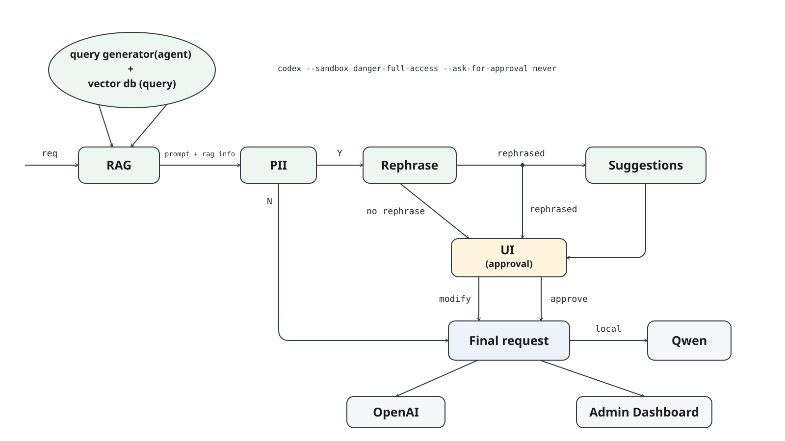
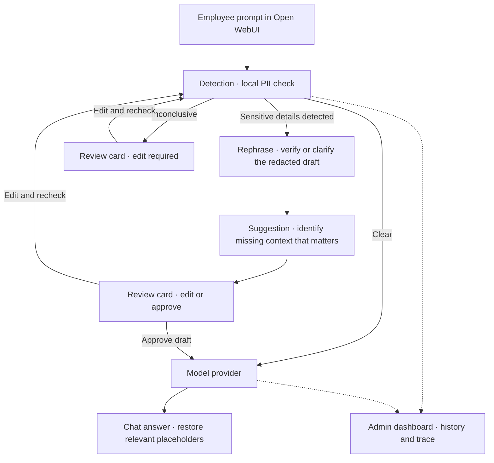

# Prompt buddy

Prompt buddy gives employees a chance to review what leaves their company when they use AI. It checks prompts for supported sensitive details, prepares a redacted draft when needed, and lets employees review it in Open WebUI. A separate admin dashboard shows the original request, the exact prompt sent to the model, and the steps that led to that decision.

## Architecture

### Target request flow



In the target architecture, a query-generation agent and vector database support RAG. The PII check receives the prompt together with any retrieved context. The **N** branch goes directly to **Final request**. The **Y** branch enters **Rephrase**. Both the original redacted draft and the rewritten draft can reach the approval UI, and **Suggestions** sends its recommendations to the same UI. The **modify** and **approve** paths converge at **Final request**. The two model destinations show the routing options, and the dashboard receives the audit record.

### What runs today

The current implementation starts with the employee's prompt. Query generation, vector retrieval, and the Qwen and OpenAI connectors in the target diagram are planned. The dashboard already reads the proxy's history and trace. The current model provider is DeepSeek. The simulated local route uses that same provider with the masked prompt.



- **Detection** runs locally. It recognizes names, email addresses, phone numbers, US Social Security numbers, and explicitly labeled contract IDs. It replaces detected values with typed placeholders.
- **Rephrase** can clarify or shorten the redacted draft. The proxy checks that the rewrite preserves the placeholders and recognized operational details. A shorter draft can use fewer input tokens on the final model call.
- **Suggestion** proposes additional context when it could materially improve the result. The review card displays suggestions only when there is an action to show.
- **Human review** takes place in the original Open WebUI message. An edit goes through another local check. Revealing a value selects it for disclosure on approval. Click it again to keep it masked. The chat can restore values in the answer when the model uses their placeholders.
- **Audit** shows the request status, risk flag, original and sent prompts, model response, and execution trace. The local app keeps request history in memory for the running session.

## Run locally

Prerequisites are Python 3.11 or newer, `uv`, a running Open WebUI instance, and a model-provider API key.

1. Export `DEEPSEEK_API_KEY` and optionally `DEEPSEEK_MODEL` in your shell. From the repository root, start the dashboard and loopback transport.

   ```sh
   PYTHONPATH=src uv run --no-project --with gradio==6.32.0 --with markdown-it-py --with jsonschema --with 'spacy>=3.8,<3.9' --with 'https://github.com/explosion/spacy-models/releases/download/en_core_web_sm-3.8.0/en_core_web_sm-3.8.0-py3-none-any.whl' -- python -m agenthon.ui.app
   ```

2. In Open WebUI, open **Admin Panel → Functions**. Create a function with ID `tdb`, paste [the Prompt buddy Pipe](src/agenthon/ui/openwebui_pipe.py), save, and enable it. Grant the intended employees access to the **TDB Privacy Proxy** model. The Pipe connects server-side to `http://127.0.0.1:8765`. If Open WebUI runs in a different network namespace, configure `TDB_PROXY_URL` on the Open WebUI server to use a private network path to the proxy.
3. Start a new chat with **TDB Privacy Proxy** and try a [synthetic request](data/demo/requests.json). Use **Check edited prompt** to update the review in place. Choose **Send redacted version** to approve the masked draft. If you reload the tab before approval, submit the request again to open a fresh review.
4. Open the admin dashboard at `http://127.0.0.1:7860` and select the request to inspect its details. Set `TDB_ADMIN_HOST` and `TDB_ADMIN_PORT` to change the dashboard listener.
